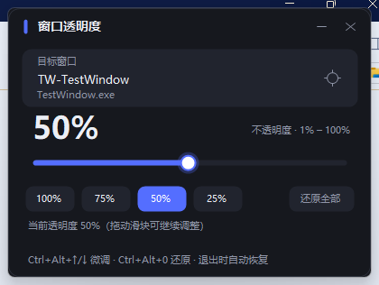
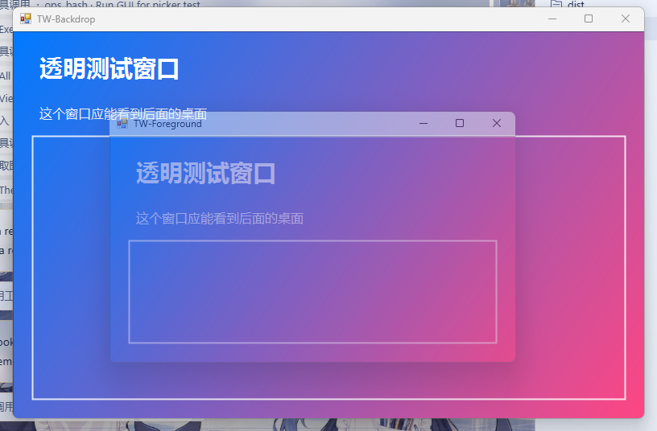

# 窗口透明度（Transparent Window）

一个免安装的 Windows 小工具：把**任意顶层窗口**的整体透明度调到 **1% – 100%**，实时生效，关闭工具时自动还原。

适用系统：**Windows 10 / Windows 11**（x64 与 x86），只依赖系统自带的 .NET Framework 4.x，不需要安装 .NET SDK 或任何运行库。

## 功能

- **1% – 100% 调节**，滑块步进 1%，并带 100% / 75% / 50% / 25% 快捷按钮。
- **两种选窗口方式**：点“目标窗口”卡片从列表里选；或点准星后直接点屏幕上的窗口。
- **全局快捷键**：Ctrl+Alt+↑/↓ 每次 ±5%，Ctrl+Alt+0 还原到 100%，主界面最小化后依然可用。
- **托盘运行**：点最小化按钮收进托盘，双击托盘图标重新打开；托盘菜单可“还原全部窗口”。
- **自动还原**：退出时恢复每个窗口的原始状态（原本就带透明度的窗口会恢复原透明度，而不是一律 100%）。
- **单实例**：重复启动会唤起已运行的窗口，不会出现两个工具互相抢窗口。
- 窗口置顶、高 DPI 感知、自绘深色界面。

## 快速使用

1. 双击 **run.bat**，或直接运行 **dist\TransparentWindow.exe**。
2. 选择要调节的窗口：
   - 点左上“目标窗口”卡片 → 在弹出的列表里双击目标窗口；或
   - 点卡片右侧的**准星**按钮 → 再点一下屏幕上的目标窗口（按 Esc 取消）。
3. 拖动滑块即可实时看到效果（最小 1%）。
4. 关闭工具窗口会自动还原所有被调整过的窗口。

> 想把本工具收起来继续用快捷键：点右上角“—”，它会缩到系统托盘。

### 快捷键

| 快捷键 | 作用 |
| --- | --- |
| Ctrl + Alt + ↑ | 透明度 +5% |
| Ctrl + Alt + ↓ | 透明度 −5% |
| Ctrl + Alt + 0 | 当前窗口还原为 100% |
| Esc | 取消取窗口模式 |

## 效果

下面是把前景窗口调到 **45%** 的效果（前景窗口能看到后面的彩色窗口）：

## 兼容性与限制

实现方式是 Win32 的 WS_EX_LAYERED + SetLayeredWindowAttributes(LWA_ALPHA)，对绝大多数普通 Win32 窗口（浏览器、记事本、Office、资源管理器、各类客户端等）都有效。

需要注意的情况：

- **目标窗口权限更高**（例如以管理员身份运行的程序）时，普通权限的本工具无法修改它，界面会提示“权限不足”。此时右键以管理员身份运行本工具即可。
- 少数使用 UpdateLayeredWindow 做**逐像素透明**的窗口（部分现代 / UWP / WinUI 应用）无法用整体 alpha 调整，会给出错误提示。
- 只处理**顶层窗口**，不处理子窗口。
- 如果工具被任务管理器强杀（非正常退出），透明度不会自动还原；重新打开工具点“还原全部”即可。
- 1% 在系统里换算成 alpha≈3/255，视觉上已接近完全透明。

## 构建

需要 Windows 自带的 .NET Framework 4.x 编译器（Win10/11 默认就有），无需 Visual Studio / .NET SDK：

    build.bat

生成 **dist\TransparentWindow.exe**（单文件，约 70 KB）。

重新生成图标（可选，需要 Python + Pillow）：

    python tools\make_icon.py

## 测试

仓库内附带两层测试，均为真实窗口读写校验：

    build_tests.bat

- **dist\test\Probe.exe**：API 层集成测试，启动一个真实的跨进程测试窗口，校验 1%、37%、45%、100% 的 alpha 回读、WS_EX_LAYERED 的加/移除、原始样式还原、窗口枚举等，共 25 项。
- **dist\test\UiE2E.exe**：UI 端到端测试（会接管鼠标键盘约 20 秒），自动点选准星、列表选窗口、快捷按钮、全局快捷键、滑块 Home 键到 1%、关闭还原等，共 22 项。

运行 UI 测试前先启动主程序：

    start dist\TransparentWindow.exe
    dist\test\UiE2E.exe

当前实测环境：Windows 11（10.0.26200），Probe 25/25 通过，UiE2E 22/22 通过。

## 目录结构

    transparent-window/
    ├─ src/                    主程序源码（C# / WinForms，C# 5 语法）
    │  ├─ Program.cs           入口、单实例、DPI
    │  ├─ MainForm.cs          主界面与交互
    │  ├─ WindowPickerForm.cs  窗口列表对话框
    │  ├─ OpacitySlider.cs     自绘滑块
    │  ├─ Ui.cs                主题、字体、绘制工具
    │  ├─ OpacityService.cs    透明度设置/还原、窗口枚举
    │  └─ Native.cs            Win32 P/Invoke
    ├─ test/                   Probe / UiE2E / TestWindow 测试源码
    ├─ tools/make_icon.py      图标生成脚本
    ├─ assets/icon.ico         应用图标
    ├─ docs/                   README 截图
    ├─ build.bat               构建主程序
    ├─ build_tests.bat         构建测试工具
    ├─ run.bat                 构建并启动
    └─ dist/                   构建产物

## 原理

1. EnumWindows 枚举可见的顶层窗口，读取标题、进程名、是否已带 WS_EX_LAYERED。
2. 设置透明度时，若窗口还不是分层窗口，则用 SetWindowLongPtr(GWL_EXSTYLE) 加上 WS_EX_LAYERED，再调用 SetLayeredWindowAttributes(hwnd, 0, alpha, LWA_ALPHA)；alpha 由百分比换算：alpha = round(pct * 255 / 100)，最小为 1。
3. 第一次修改前记录窗口的原始 EXSTYLE / 透明度 / 标志位，退出或点“还原全部”时完整恢复，避免影响本来就有透明效果的窗口。
4. 取窗口用全局鼠标状态 + WindowFromPoint + GetAncestor(GA_ROOT)，因此可以精确点选任意窗口。
